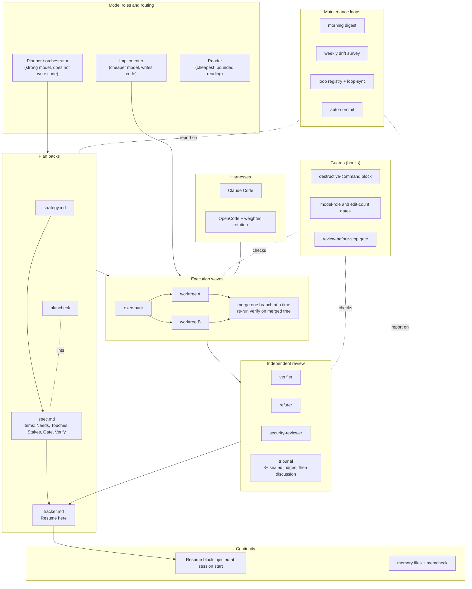

# Architecture

This is how the whole system fits together, layer by layer. The [README](README.md) is the short tour; this
file is the longer one. Each section ends with **In this repo:** (what you can open and run) or
**Described only** (the idea is explained here, but the files are not included).



## 1. Model roles and routing

Each model has one job. A strong model plans, decides and orchestrates. A cheaper model writes the code, but
only through a dedicated `implementer` agent that receives a written brief. The cheapest model does bounded
reading: it looks things up and reports back, it never designs. Interface and UI work goes to a separate
builder and critic pair.

Routing is a table, not a mood. A request is classified by task kind and by stakes, and the table says which
role handles it and what review it owes. A decided, non-UI change goes to the implementer. High-stakes
changes (cryptography, migrations, concurrency, authorization, money, security boundaries) add a
security review and a tribunal. Hooks check the table where a prompt alone would be forgotten (see
[section 5](#5-guards)).

In this repo: [`rules/dispatch-router.md`](rules/dispatch-router.md),
[`rules/stakes-dial.md`](rules/stakes-dial.md), [`agents/`](agents/), and a report-only router,
[`scripts/route.py`](scripts/route.py), which prints the route for a described task but dispatches nothing.

## 2. Plan packs

Anything larger than a small fix becomes a **plan pack** in `plans/<topic>/`: three files.

- **strategy**: why this exists and what outcome counts.
- **spec**: numbered items. Each names `Needs:` (what must be done first), `Touches:` (the only files it may
  edit), `Stakes:` and a `Verify:` command that proves it.
- **tracker**: current state, a decision log, and a `Resume here` block.

Packs come in tiers, from a one-paragraph note to a full strategy with open questions, so ceremony matches
size. Each item carries a **Gate**. `Gate: auto` means the agents start it as soon as its `Needs:` are
done. `Gate: human` is reserved for decisions only a person should make: scope, money, anything published,
product taste. Merges and technical fixes are never human gates; they go through a reviewer instead.

The **stakes dial** sets review depth per item: LOW gets deterministic checks only, STANDARD gets one review
pass and at most one fix round, HIGH gets the full ladder (security review and tribunal, refutation of
serious findings, at most two rounds). Review rounds are counted per lineage of an item, so a repair does not
buy a fresh budget. `plancheck` lints a pack: missing fields, dangling `Needs:`, items without a verify
command.

In this repo: [`skills/plan-pack/`](skills/plan-pack/), [`templates/planning/`](templates/planning/),
[`tools/plancheck/`](tools/plancheck/) (runnable, with tests and a deliberately broken example pack).

## 3. Execution waves

[`exec-pack`](skills/exec-pack/) reads the spec's `Needs:` graph and groups items into **waves**: everything
whose prerequisites are done runs in parallel. Each worker gets its own git worktree and a brief that names
its item, its allowed `Touches:` files and its verify command. A worker that needs a file outside its fence
stops and says so rather than editing it.

Merging is serial. The orchestrator merges one branch, re-runs the verify loop on the merged tree, and only
then takes the next. A reviewer reads each merge according to its stakes. A failed merge is fixed forward or
reverted, not argued about. Each wave also carries at least one item whose output a human can open and read,
so progress is visible and not only internal.

In this repo: [`skills/exec-pack/`](skills/exec-pack/), [`skills/execution/`](skills/execution/),
[`skills/delegation/`](skills/delegation/), [`templates/worker-brief.md`](templates/worker-brief.md),
[`tools/gate-check/`](tools/gate-check/). The worktree and merge steps are instructions an agent follows; no
scheduler is included.

## 4. Independent review

The maker never grades its own work.

- **verifier**: a fresh-context agent that checks an item against its spec and runs its verify command.
- **refuter**: takes one finding and tries to disprove it, so effort is not spent on false alarms.
- **security-reviewer**: reviews diffs in the sensitive classes above, read-only.
- **tribunal**: for high stakes. Three or more judges with different lenses (and, where available, from
  different model families) each write a **sealed** opening review without seeing the others. They are then
  put in a shared transcript file and discuss until they stop finding new things. The orchestrator, acting as
  scribe, writes the final report. The transcript is append-only and hash-chained, written only by the
  scribe tool, so a seat cannot rewrite history.

A clean result (`SOUND`) is a valid verdict. Reviewers are asked to try seriously to break the work, not to
produce findings.

In this repo: [`agents/verifier/`](agents/verifier/), [`agents/refuter/`](agents/refuter/),
[`agents/tribune/`](agents/tribune/), [`agents/security-reviewer.md`](agents/security-reviewer.md),
[`skills/tribunal/`](skills/tribunal/), [`tools/tribunal-scribe/`](tools/tribunal-scribe/) (runnable, tested).

## 5. Guards

Guards are hooks: small programs the harness runs before or after a tool call. They exist because an
instruction a model can forget is only a suggestion. Every shipped guard fails closed when it cannot parse the
payload the harness hands it (pre-tool hooks deny, stop hooks block). Past that point, the safety-critical ones
fail closed on any internal error. The nudge-style ones (edit budget, review-stop, tracker check) also treat an uncaught crash as a deny or block through a shared crash guard, so a broken gate stops work visibly instead of silently passing; a missing transcript still lets the edit-budget call through. The model gates need `python3`; the Bash guard denies without it.

| Guard | What it blocks | Why | On error |
|---|---|---|---|
| Destructive-command guard | Wiping the root or home directory, overwriting block devices, fork bombs, recursive permission changes on `/`. It inspects the real command in command position, so documentation that merely mentions these tools passes. | Deny-rules in settings are prefix matches that miss reordered flags; a best-effort tripwire against accidental destructive commands, not a security boundary against an adversarial agent (it pattern-matches bash text and cannot parse every bash form; see plugins/gates/README.md Known limitations). | Fails closed |
| Planner code guard | Code edits by a model configured as an orchestrator. Docs, config and tiny edits pass. | Keeps the expensive model planning and the cheap one typing. | Fails closed (denies when the model is undetermined) |
| Edit-count gate | Direct code edits past a per-model budget in a session by the main model; the rest must be delegated. The budget is configurable and the shipped default `edit_budget_models` is `{}` (off). A human can lift it with an explicit phrase. | A soft reminder was ignored in measurement; a block was not. | Denies/blocks on a crash (crash guard) |
| Large-read gate | Repeated unbounded reads of big files in the main session. | Reads belong in bounded subagents; the main context stays small. | Described only (not in plugin) |
| Review-before-stop gate | Ending a turn after editing UI or security-sensitive code when the critic or security reviewer never ran. Edits that were themselves denied do not count. | Proves the review was invoked, once per cycle. | Blocks once on a crash (crash guard), loop-safe |
| Tracker check | Ending a session whose active tracker has no current Resume block (nudges once). | Continuity is a rule, not a hope. | Blocks once on a crash (crash guard) |
| Write boundary | Edits outside a directory the user froze for the session. Symlinks are resolved first. | Scopes a risky session to one folder. | Described only (not in plugin) |
| Read-only reviewers | Writes by reviewer agents, and git commands that execute programs named in a repository's own config. | A reviewer that can run code is not read-only. Parsing shell commands for this proved bypassable, so the recommended form is a reviewer agent with no Bash tool at all. | Described only (not in plugin) |

Guards are configured at user level: the plugin reads no project config files for its settings. Claude Code settings are outside the plugin's control, so a project's Claude Code settings file (`<project>/.claude/settings.json`) can still set `disableAllHooks`, `enabledPlugins: false` or `env` values. The read-only reviewers row is described only; it is not an enforcing guard.

In this repo: [`plugins/gates/`](plugins/gates/), an opt-in plugin with its own tests and a
provenance file per hook. Rows marked "Described only" run in my private setup but are not in the plugin.

## 6. Continuity

Context is disposable; the tracker is not. Three pieces:

- **Resume block.** Every tracker has a `## Resume here` block: what has been delivered, the current state
  and the exact next action. It is overwritten, never appended, at every milestone.
- **Resume injection.** A session-start hook finds the newest active tracker and puts its Resume block (and an
  optional short program-purpose file) into the new session's context, so clearing or compacting a full
  context costs nothing. The injected text is marked as untrusted data, and the hook fails open.
- **Memory files.** Long-lived facts sit in small markdown files behind an index. `memcheck` lints them for
  broken links, index drift and stale entries, and can repair the index on request.

In this repo: [`skills/continuity/`](skills/continuity/), [`skills/lifecycle/`](skills/lifecycle/),
[`rules/continuity.md`](rules/continuity.md), [`templates/resume.md`](templates/resume.md),
[`tools/memcheck/`](tools/memcheck/) (runnable, tested). The session-start injection hook is in
[`plugins/gates/`](plugins/gates/).

## 7. Two harnesses

The same skills and agent roles run in Claude Code and in OpenCode. A bridge generates OpenCode agent
definitions from the Claude ones, so there is one source of truth. In OpenCode, worker models from several
providers can be placed in a **weighted pool**: each dispatch of a rotated role (implementer, verifier,
refuter and so on) draws a model by weight. Rotation is for gathering evidence about which models do which
jobs well; it never reads earlier outcomes to optimize itself, and any error leaves the dispatch untouched.

In this repo: [`adapters/`](adapters/) describes the Claude Code, OpenCode and generic setups.
[`opencode/`](opencode/) holds the OpenCode guard bridge (runnable, tested with a stub parser for its Bash
check), the agent generator, and opt-in weighted rotation (tested); the Claude Code rotation hook is in
[`plugins/gates/hooks/rotation/`](plugins/gates/hooks/rotation/).

## 8. Maintenance loops

Recurring work is run as registered loops rather than prompted by hand. A **loop registry** is a table: each
loop has a tier, a mechanism, a cadence and a gate. Tier L1 is report-only and writes only its own report
files; L2 proposes edits behind a human approval; L3 acts unattended and needs a hard budget and a rollback.
Scheduled, headless runs are L1 by construction, because they cannot ask a question. Moving a loop up a tier
is a deliberate edit to the registry.

The loops I run:

- **Morning digest**: daily checks of the setup (linters, drift, pending items) written to one report.
- **Weekly drift survey**: a read-only agent re-maps skills, agents and hooks and lists what drifted.
- **Loop registry and `loop-sync`**: verifies every registered loop is actually wired, so a loop marked live
  that is not running shows up as drift.
- **Auto-commit**: a timer commits and pushes registered repositories every few minutes, so nobody asks
  whether to commit.

Timers are plain systemd user units. A generic example:

```ini
# ~/.config/systemd/user/morning-digest.service
[Service]
Type=oneshot
ExecStart=%h/bin/morning-digest

# ~/.config/systemd/user/morning-digest.timer
[Timer]
OnCalendar=*-*-* 06:00
Persistent=true
[Install]
WantedBy=timers.target
```

Enable it with `systemctl --user enable --now morning-digest.timer`.

In this repo: [`tools/loop-sync/`](tools/loop-sync/) with a [registry template](tools/loop-sync/LOOPS.template.md)
(runnable, tested), and [`skills/maintenance/`](skills/maintenance/). The digest, survey and auto-commit
scripts are **described only**; the timer units above are an example, not shipped files.

## What stays private

My personal writing and voice system, and my personal data (notes, accounts, schedules, usage records), are
not part of this repository.
