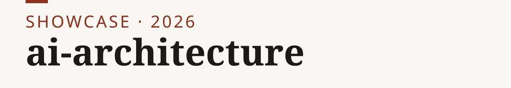
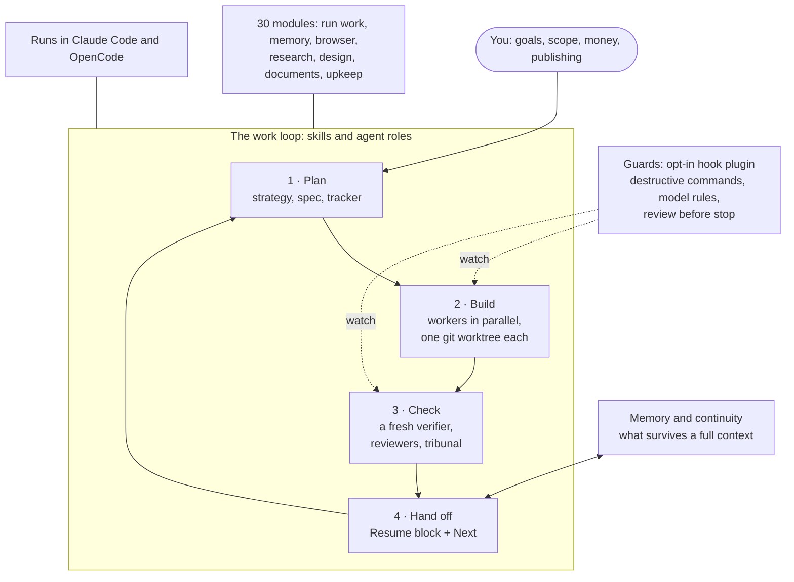

<p><picture><source media="(prefers-color-scheme: dark)" srcset="assets/banner-dark.svg"></picture></p>

**My entire philosophy for my Claude Code setup, as a collection you can read, try and borrow from.**

[What it is](#what-this-is) · [The whole system](#the-whole-system-in-one-picture) · [Words](#words-used-here) · [What's inside](#whats-inside) · [Try it](#try-it-in-two-minutes) · [Use with your AI](#use-with-your-ai) · [For AI agents](#for-ai-agents-reading-this-repository) · [Install](INSTALL.md)

[](LICENSE) [](LICENSE-docs) [](CHANGELOG.md)

## What this is

Left alone, coding agents drift: the scope widens, the agent grades its own homework, a destructive command slips
through, and everything it knew dies when the context fills up. I built my Claude Code setup to stop that. It turns
one agent into a small team where every job has an owner: one model plans, another writes the code, a third checks
it, and nobody marks their own work as done.

This repository is that setup, made public so other people don't have to start from scratch. It holds:

- **the working method**: skills (written instructions an agent follows), agent roles and rules for planning,
  building, reviewing and handing off work;
- **guard hooks**, an opt-in plugin that catches common mistakes;
- **30 modules** of small Python tools for running work, memory, browsers, research, design, documents and upkeep;
- **a registry of 72 capabilities** that says, row by row, how far each one runs from this repository today.

**Who it is for:** people who use Claude Code or OpenCode and want ideas or parts for their own setup, and the AI
assistants they ask to evaluate it. It is a preview, built and used on one Linux machine, and it grew out of my own
work, so research and personal projects show up a lot. It is not a product you install and forget. You can take
all of it, one idea, or nothing.

## The whole system in one picture



You decide what gets built and anything that costs money or goes public. The agents handle the rest: they plan,
build, check each other and write down where they stopped, so the next session can pick up after the agent has
forgotten the conversation.

## Words used here

| Word | Meaning |
|---|---|
| Harness | The program the agent runs in: Claude Code, or [OpenCode](https://opencode.ai), an open-source alternative. |
| Skill | A Markdown file of instructions an agent follows for one kind of task. Nothing runs by itself. |
| Agent role | A named sub-agent with one job, such as `implementer` (writes code) or `verifier` (checks it). |
| Plan pack | A folder `plans/<topic>/` with up to three files: a strategy (why), a spec (numbered items, each with a check command) and a tracker (progress). Small work gets only a tracker. |
| Gate | A line on a spec item. `Gate: auto` means agents build it on their own; `Gate: human` means a person decides first. |
| Resume block | The `## Resume here` section near the top of a tracker: what was delivered, where things stand, the next action. It is overwritten, never appended. |
| Worktree | A second checkout of the same git repository in its own folder, so parallel workers don't touch each other's files. |
| Verifier, tribune, refuter | Reviewer roles. A verifier checks work against its spec; a tribune reviews from one stated angle; a refuter tries to disprove one finding. |
| Tribunal | Three or more tribunes with different angles who review on their own first, then argue in a shared transcript. |
| Stakes dial | The rule for how much review a change gets, from a test run for a typo to a tribunal for a high-stakes plan ([`rules/stakes-dial.md`](rules/stakes-dial.md)). |
| Module | A folder under `modules/` with Python code, a README, a `modules/<name>/descriptor.json` and, for all but `contracts`, its own tests. |
| Capability | One row in [`capabilities/registry.json`](capabilities/registry.json): a feature, its state, and evidence files that point to the modules, skills or tools behind it. |

How the counts fit together: **skills**, **roles** and **commands** are instructions; **tools** (`tools/`) are
small command-line programs for plan packs; **modules** are larger components; and the **72 capabilities** describe
features that the skills, tools and modules together provide.

## How it works, in eight ideas

1. **Every model has a job, and the expensive ones don't type.** A strong model plans and orchestrates, a cheaper one
   writes code through an `implementer` agent, and the cheapest does bounded reading. The guard plugin can enforce
   this: it denies code-file writes from models you list as planners (tiny single edits pass) and caps how many code
   edits an orchestrator makes before it must delegate. Writes through the shell are not covered.
2. **Work starts as a plan pack.** Anything bigger than a small fix gets a strategy, a spec and a tracker.
   `plancheck` lints them. Items are `Gate: auto` unless they need a real human decision: scope, money, publishing
   or taste.
3. **Builds run in waves.** `exec-pack` reads which items depend on which and runs independent ones in parallel, each
   worker in its own worktree and limited to the files its item names. Branches merge one at a time, and the checks
   run again on the merged result.
4. **Nobody grades their own work.** A `verifier` with a fresh context checks each item against its spec. Risky
   changes also get a `security-reviewer` and a `tribune` with a different angle. High-stakes decisions and plans go
   to a tribunal, and at high stakes a `refuter` tries to disprove each serious finding before anyone acts on it.
   These are written procedures an agent follows; `tools/tribunal-scribe` is the runnable part.
5. **Guards catch common mistakes.** The opt-in hook plugin is a best-effort tripwire against accidental destructive
   shell commands: it denies catastrophic ones and asks before recoverable ones. It also stops a session from ending
   while a required review is missing, and reminds you once when a tracker has no current Resume block. It is not a
   security boundary; see its [known limitations](plugins/gates/README.md).
6. **Context is disposable; the tracker is not.** The Resume block is overwritten at each milestone and loaded into
   the next session, so clearing a full context costs nothing. Long-lived facts live in small, linted memory files.
7. **Two harnesses, one system.** The same skills, roles and guards are written for Claude Code and for OpenCode,
   where worker models from several providers can be rotated by weight.
8. **Upkeep runs on timers.** In my setup a morning digest, a weekly drift survey and a check that every scheduled
   loop is still wired run on timers. Here, the loop check (`tools/loop-sync`) runs and is tested; the digest and
   survey scripts are described only, and the timer units in [ARCHITECTURE.md](ARCHITECTURE.md) are an example.

## What's inside

Three kinds of things live here, and it helps to know which is which:

- **Instructions**: skills, roles, commands and rules. An agent reads and follows them; nothing runs by itself.
- **Runnable tools**: Python 3 (standard library) and bash, offline, with tests. Some capabilities also use common system
  tools you install, such as git, headless Chrome, ffmpeg or pandoc; the registry lists them per capability as
  optional requirements.
- **Declarations**: a description of something that needs a backend or companion this repository does not include.

### The working method

| Part | What it does | Kind | Where |
|---|---|---|---|
| 21 skills | Planning (`plan-pack`), building (`exec-pack`), review (`tribunal`), routing, research, design and more | instructions | [`skills/`](skills/), listed in [CATALOG.md](CATALOG.md) |
| 13 agent roles | `implementer`, `verifier`, `tribune`, `refuter`, `security-reviewer`, `surveyor` and others | instructions | [`agents/`](agents/) |
| 6 commands | plan, execute, review, checkpoint, research, health (named `/ai-architecture:plan` and so on when installed as a plugin) | instructions | [`commands/`](commands/) |
| Rules and templates | The stakes dial, routing rules, and the plan, brief, review and Resume records | instructions | [`rules/`](rules/), [`templates/`](templates/) |
| Pack tools | `plancheck`, `gate-check`, `tribunal-scribe`, `memcheck` (memory linter), `loop-sync` (timer registry check) | runnable, tested | [`tools/`](tools/) |
| Guard hooks | Destructive commands, model rules, review before stop, tracker check | runnable, tested, opt-in plugin | [`plugins/gates/`](plugins/gates/README.md) |
| OpenCode bridge and model rotation | The same guards in OpenCode, and weighted model pools | runnable, opt-in; tested with a stub parser, not yet in a live OpenCode session; the rotation module's tests need `bun` | [`opencode/`](opencode/README.md) |
| Adoption guide | Lets your agent take parts of this into your setup without replacing your files | instructions | [`adapters/adopt.md`](adapters/adopt.md) |
| Personal writing and voice tooling, personal data | — | not included | — |

### The 30 modules

Each module is a folder under [`modules/`](modules/) with a README, a `modules/<name>/descriptor.json` and tests
(`contracts` is tested from [`tests/`](tests/)).

| Area | Modules | What they give you |
|---|---|---|
| Running work | `orchestration`, `autopilot`, `continuity`, `control-plane-adapters`, `isolation`, `installer` | Send a task to a worker and get a typed result back, work through a plan pack within a budget, survive a crashed coordinator, limit memory and CPU, sandbox a command, install and roll back files |
| Memory and knowledge | `memory`, `memory-backends`, `memory-operations`, `knowledge-adapters` | Search notes you name, a small block for session start, capture what happened in a session, promote it into curated memory, read-only adapters to a knowledge backend you declare |
| Review and quality | `review`, `development`, `model-evaluation` | Review receipts tied to the exact artifact, checks for debug, secure-build, security-audit and incident work, model bake-offs and scoreboards |
| Research | `research-integrity`, `research-adapter` | Run a research project from first query to release, and drive the public [provenote](https://github.com/nik110403/provenote) research companion |
| Browser and outside actions | `browser`, `browser-operations`, `productivity`, `documents`, `git-automation` | A browser protocol with an optional headless Chrome backend, mail and calendar behind explicit permission, office files, commit and approved push |
| Making things | `design-pipeline`, `media`, `writing` | A UI pipeline with rendered screenshots and critique, slides, visuals and short videos, routing prose to the right register |
| Keeping the setup healthy | `maintenance`, `observability`, `stewardship`, `state-adapters`, `config-sync`, `discovery-inbox` | A loop registry with health reports, usage and cost reports, project registration and linting, a project export with a static viewer, drift detection for MCP servers, skills and agents, and a lane for tool discovery through a companion |
| Shared | `contracts` | The common event, result and status records the modules use |

### The capability registry

[`capabilities/registry.json`](capabilities/registry.json) lists 72 capabilities, from "intent routing" to
"installer patterns". Each row gives its state, the evidence files, its dependencies and a next setup step. Two
states are used:

- **partial** (59 rows): it runs from this repository on your machine, sometimes with fake inputs or a common tool
  you install. This is the furthest any row goes today.
- **planned** (13 rows): only declared so far, or it needs a companion or backend that is not included.

No row is marked `available`. A module's own `modules/<name>/descriptor.json` can be more cautious than its registry rows; the
registry holds the per-capability state. Read it with `python3 -B scripts/capabilities.py status`, or see
[CAPABILITIES.md](CAPABILITIES.md) for the map in prose.

## Try it in two minutes

These run offline with Python 3, with no model and no network, in a few seconds each. Clone the repository and run
them from its root:

```bash
python3 -B scripts/capabilities.py status          # all 72 capabilities with state and next step
python3 -B examples/system-journey/run.py          # one request routed, briefed, checked and handed off
python3 -B examples/continuity/run.py              # a saved Next action survives a restart
python3 -B examples/native-system/run.py --offline # a request survives a killed coordinator (fakes only)
```

There are 14 examples in [`examples/`](examples/), covering most areas (design, media, documents, memory, research
and more). The [worked example](examples/worked-example/README.md) shows one full maker, fresh checker and Resume
cycle on a small parser.

## A real example

While porting the guard hooks, a three-judge review found that "read-only" reviewer agents could still run code:
`git status` and `git diff` execute programs named in a repository's own git config. The same gap existed in my
private setup. Two rounds of parser fixes each closed one bypass, and each time the judges found the next one. So
the guard was dropped from the plugin, and the documentation now recommends reviewer agents with no shell access at
all. That loop is what the system is for: build, review independently, try to refute, fix, and stop when patching
stops converging.

## Use with your AI

You don't have to take all of it, or anything at all. Point your AI at this repository and ask what is worth taking
for you. An idea copied into your own instructions counts as much as an installed skill. This prompt keeps your AI
read-only:

```text
Read this repository, starting with README.md, ARCHITECTURE.md and CATALOG.md, and
compare it with how I work today. Do not install, copy or change anything. Tell me
the three to five ideas or components most worth taking for me, why each one fits,
and what adopting it would cost. Ideas I could write into my own instructions count
as much as files I could install. Say which ones you would skip and why.
```

To adopt what you picked, you don't need a plugin. Clone or download the repository, open your Claude Code session
in the folder, and give your agent the prompt below. It follows the [adoption guide](adapters/adopt.md): it asks
which scope it may look at, inventories what you already have, and only adds. It never replaces your files, and it
changes hooks or settings only after you approve each exact diff. It leaves a receipt that says how to undo
everything.

```text
Adopt the AI Architecture collection into my setup by following its adoption guide,
adapters/adopt.md, step by step. Before you change anything, ask me which scope you
may look at (my user-level Claude Code directory, or this project), then take an
inventory of that scope and write it down. Only add things: never replace, delete or
overwrite a file of mine. The only change allowed to a file that already exists is one
marked block appended to it, and only after you listed it for me and backed the file up.
Leave hooks and settings alone unless I say yes to each exact hook or settings change
after you show me the diff. When you finish, leave a receipt that says what you installed, what you could not, and how to undo it.
```

The plugin route is under [Install](#install) and in [INSTALL.md](INSTALL.md).

## For AI agents reading this repository

If a person asked you to evaluate or explain this repository, this section is your map. Stay read-only unless they
asked you to adopt something; then follow [adapters/adopt.md](adapters/adopt.md).

**Read in this order:**

1. This README, for the shape of the whole system and the [words](#words-used-here) it uses.
2. [CATALOG.md](CATALOG.md) for every skill, role and command, with one line each.
3. [CAPABILITIES.md](CAPABILITIES.md) and [`capabilities/registry.json`](capabilities/registry.json) for each of
   the 72 capabilities: state, evidence, dependencies and next setup step.
4. [ARCHITECTURE.md](ARCHITECTURE.md) and [WORKFLOWS.md](WORKFLOWS.md) for how the parts connect.
5. For anything you plan to recommend, the thing itself: `modules/<name>/README.md` and
   `modules/<name>/descriptor.json`, or `skills/<name>/SKILL.md`.

**Where the truth is:**

| Question | Source |
|---|---|
| What exists? | [CATALOG.md](CATALOG.md) and the folders `skills/`, `agents/`, `commands/`, `modules/`, `tools/` |
| How far does a capability run, and with what? | `capabilities/registry.json`: fields `support`, `evidence`, `dependencies`, `next_setup_action`, `optional_requirements` |
| What was tested, and how? | [COVERAGE.md](COVERAGE.md) and each module's `tests/` |
| Where did a ported file come from? | its provenance record: `<entry>/PROVENANCE.md`, `<name>.PROVENANCE.md` for rules, `agents/<name>/PROVENANCE.txt` for roles |
| What changed in this release? | [CHANGELOG.md](CHANGELOG.md) |

**Rules of thumb:**

- A skill or role file is instructions. It grants no tools, permissions or isolation; the harness decides those.
- `partial` means it runs here, possibly with fakes. `planned` means not yet. Report neither as available.
- Check claims instead of trusting prose: the commands in [Try it](#try-it-in-two-minutes) run offline in seconds,
  and `python3 -B scripts/check_collection.py` validates the whole collection.
- When you recommend something, name its folder, what it depends on, and what it would cost the person to adopt.

## Install

```text
/plugin marketplace add nik110403/ai-architecture
/plugin install ai-architecture@ai-architecture          # skills, roles, templates, tools
/plugin install ai-architecture-gates@ai-architecture    # optional: the guard hooks (read plugins/gates/README.md first)
```

Or copy a single skill and what it declares it needs into your project. `plan-pack` also needs the root-level
templates and tools, and its larger builds use companion skills and configured roles.
[INSTALL.md](INSTALL.md) covers OpenCode, user-level guard configuration and partial adoption.

## Design decisions

1. **Maker and checker are always different contexts.** A worker reviewing its own output shares its blind spots.
2. **Rules that matter are hooks, not prompts.** An instruction a model can forget is a suggestion.
3. **Humans approve strategy, agents decide technique.** Gates sit on scope, money, publishing and taste. Merges and
   fixes go through a reviewer instead of a person.
4. **Ceremony scales with stakes.** A typo fix gets a test run. A security boundary gets a `security-reviewer` and a
   `tribune` with a different angle, and a high-stakes plan gets a full tribunal.
5. **Guards are tripwires, configured at user level.** Static text checks catch common destructive command forms;
   they are not a sandbox, and some command classes are allowed on purpose. The plugin reads its configuration only
   from your user scope, so a repository cannot loosen it through the plugin's own config files. A project's
   `<project>/.claude/settings.json` is outside the plugin's control and can still set `disableAllHooks`,
   `enabledPlugins: false` or `env` values.
6. **Few dependencies.** The tools need bash and Python 3's standard library, so they run offline and don't rot.

Every ported file records where it came from and what changed in its provenance record. A privacy scan
(`scripts/privacy_scan.py`) runs before every release as a tripwire for common personal markers in the public tree.

## Limits

- **Preview, one machine.** Built and used on one Linux machine with Claude Code and OpenCode. Other systems are
  untested, apart from one adoption smoke run on Windows 11 that did not pass every check. On Windows the tools need
  bash, Python 3 and GNU coreutils; WSL is closest to what was tested.
- **No capability is marked available.** 59 run from this collection with fakes or declared tools; 13 need something
  not included.
- **Adoption was rehearsed once.** A Claude Code agent followed the adoption guide in this release onto a test home we
  prepared with its own CLAUDE.md, settings and skills. A separate checker found every existing file unchanged outside
  marked blocks, a second run changed nothing, and rollback restored the starting state. But 0 of 14 chosen
  capabilities passed their check, run by the same agent: 8 were installed but not checked, and 6 were marked
  unavailable. Hooks were not rehearsed. All runs, including the failed ones, are in
  [examples/adoption/REHEARSAL.md](examples/adoption/REHEARSAL.md). No outside person has adopted it yet.
- **Skills depend on the model.** They are instructions, so results vary with the model that follows them.
- **Hooks depend on Claude Code.** The guard hooks read Claude Code's hook payloads and transcript format, which can
  change between versions.

See [COVERAGE.md](COVERAGE.md) for what has been tested and how.

## License

Code and instruction assets are [MIT](LICENSE); documentation and images are CC BY 4.0 ([LICENSE-docs](LICENSE-docs)),
mapped file by file in [LICENSES.md](LICENSES.md). Cite via the "Cite this repository" button ([CITATION.cff](CITATION.cff)).

Built by [Nik Khosravipour](https://nikkhosravipour.com).
