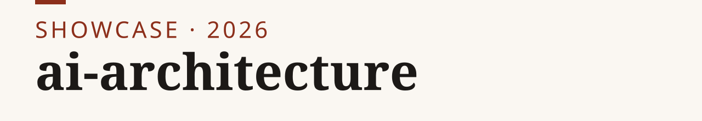
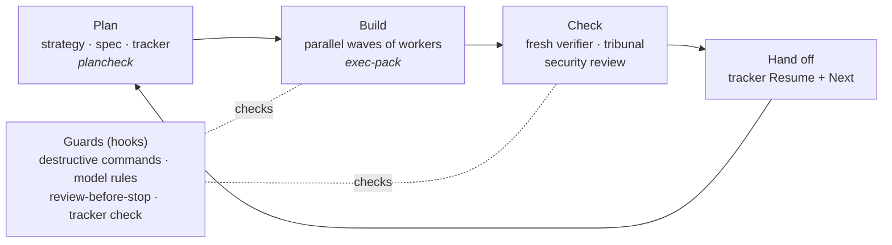

<p><picture><source media="(prefers-color-scheme: dark)" srcset="assets/banner-dark.svg"></picture></p>

**My Claude Code and OpenCode setup, made generic: AI agents that plan, build, check each other and hand off like a small engineering team.**

[Install](INSTALL.md) · [Catalog](CATALOG.md) · [Architecture](ARCHITECTURE.md) · [How it works](#how-the-system-works) · [Site](https://nikkhosravipour.com)

[](LICENSE) [](LICENSE-docs) [](CHANGELOG.md)

I run most of my software and research work through coding agents. Left alone, they drift: the scope widens,
the agent grades its own homework, a destructive command slips through, and everything it knew dies when the
context fills up. This repository is the machinery I built against that, taken out of my private setup and
made to run on anyone's machine.



## How the system works

**1. Every model has a job, and the expensive ones don't type.** A strong model plans and orchestrates; a
cheaper one writes the code through an `implementer` agent; the cheapest does bounded reading. This is not a
convention: hooks block code edits by models configured as planners and cap how many edits an orchestrator may
make before it must delegate.

**2. Work starts as a plan pack.** Anything bigger than a small fix becomes `plans/<topic>/` with a strategy
(why), a spec (items with `Needs:`, `Touches:`, `Stakes:` and a `Verify:` command) and a tracker. `plancheck`
lints the pack. Each item is either `Gate: auto` (the agents just build it) or `Gate: human` (only for real
decisions: scope, money, publishing, taste).

**3. Builds run in waves.** `exec-pack` turns the spec's dependency graph into waves of parallel workers, each
in its own git worktree, fenced to the files its item declares. The orchestrator merges one branch at a time
and re-runs the verify loop on the merged tree.

**4. Nobody grades their own work.** A fresh-context `verifier` checks each item against its spec. High-stakes
changes also get a `security-reviewer` and a **tribunal**: three or more judges with different lenses review
sealed, then argue in a shared transcript until they stop finding things. A `refuter` tries to disprove each
finding before anyone acts on it.

**5. Guards catch common mistakes.** An opt-in hook plugin is a best-effort tripwire against accidental destructive shell commands (not a security boundary; see its Known limitations), stops a session from
ending while a required review is missing, and nudges once when a session ends with a tracker that has no current Resume
block.

**6. Context is disposable; the tracker is not.** Each tracker carries a `Resume here` block (what was delivered,
current state, next action), overwritten at every milestone and injected into the next session. Clearing a
full context costs nothing. Long-lived facts live in small, linted memory files.

**7. Two harnesses, one system.** The same skills, agent roles and guards run in Claude Code and in OpenCode,
where worker models from several providers can be rotated by weighted pool.

**8. Maintenance runs on timers.** A morning digest, a weekly survey of the whole setup for drift, and a check
that every scheduled loop is still actually wired.

## What is in this repository

| Part | State | Where |
|---|---|---|
| Plan packs: plan-pack, exec-pack, tribunal skills + templates | in the repo (instructions) | `skills/`, `templates/` |
| `plancheck`, `gate-check`, `tribunal-scribe` | runnable, tested | `tools/` |
| Agent roles: implementer, verifier, tribune, refuter and more | in the repo | `agents/` |
| Stakes dial and routing rules | in the repo | `rules/` |
| Guard hooks (destructive commands, model rules, review gate, tracker check) | runnable, opt-in plugin | `plugins/gates/` |
| OpenCode bridge (same guards, plus a Bash check) and agent generator | runnable, opt-in; tested with a stub parser, not yet in a live OpenCode session | `opencode/` |
| Weighted model rotation (Claude Code hook + OpenCode module) | opt-in, tested (the OpenCode module half needs `bun`) | `opencode/rotation/`, `plugins/gates/hooks/rotation/` |
| `memcheck` (memory linter), `loop-sync` (timer registry check) | runnable, tested | `tools/` |
| Specialist workflows: review, discovery, continuity, research and more | in the repo (instructions) | `skills/` |
| Timer definitions for the maintenance loops | described only | [ARCHITECTURE.md](ARCHITECTURE.md) |
| Personal writing and voice tooling, personal data | not included | — |

Every ported file records where it came from and what changed in a PROVENANCE.md file next to it (PROVENANCE.txt for agents). A privacy
scan (`scripts/privacy_scan.py`) runs before every release as a tripwire for common personal markers in the public tree.

## A real example

While porting the guard hooks for this release, a three-judge review found that "read-only" reviewer agents
could still run code: `git status` and `git diff` execute programs named in a repository's own git config. The
same gap existed in my private setup. Two rounds of parser fixes each closed one bypass, and the judges found
the next one, so the guard was dropped from the plugin; the documentation now recommends reviewer agents with
no shell access at all. That loop — build, independent review, refute, fix, and stopping when patching stops
converging — is what the system is for.

## Install

```text
/plugin marketplace add nik110403/ai-architecture
/plugin install ai-architecture@ai-architecture          # skills, roles, templates, tools
/plugin install ai-architecture-gates@ai-architecture    # optional: the guard hooks (read plugins/gates/README.md first)
```

Or selectively copy a skill and its declared dependencies into your project. `plan-pack` also needs
root-level templates and tools; its T2+ execution uses companion skills and configured roles.
[INSTALL.md](INSTALL.md) covers OpenCode, user-level guard configuration and partial adoption.

## Design decisions

1. **Maker and checker are always different contexts.** A worker reviewing its own output shares its blind spots.
2. **Rules that matter are hooks, not prompts.** An instruction a model can forget is a suggestion.
3. **Humans approve strategy, agents decide technique.** Gates sit on scope, money, publishing and taste; merges
   and fixes go through a reviewer instead of a person.
4. **Ceremony scales with stakes.** A typo fix gets a test run; a security boundary gets a tribunal.
5. **Guards fail closed and are configured at user level.** The plugin reads its configuration only from your user scope, so a repository cannot loosen it through this plugin's config files. Claude Code settings are outside the plugin's control: a project's Claude Code settings file (`<project>/.claude/settings.json`) can still set `disableAllHooks`, `enabledPlugins: false` or `env` values.
6. **Standard library only.** The tools need bash and Python 3, so they run offline and don't rot.

## Limits

This is a preview. The workflows were built and used on one Linux machine; other operating systems are untested.
Skills are instructions an agent follows, so results depend on the model. The guard hooks rely on Claude Code's
hook payloads and transcript format, which can change between versions. See [COVERAGE.md](COVERAGE.md) for what
has been tested and how.

## License

Code and instruction assets are [MIT](LICENSE); documentation and images are CC BY 4.0 ([LICENSE-docs](LICENSE-docs)),
mapped file by file in [LICENSES.md](LICENSES.md). Cite via the "Cite this repository" button ([CITATION.cff](CITATION.cff)).

Built by [Nik Khosravipour](https://nikkhosravipour.com).
