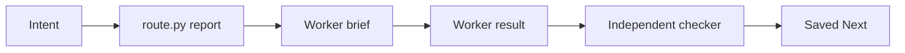
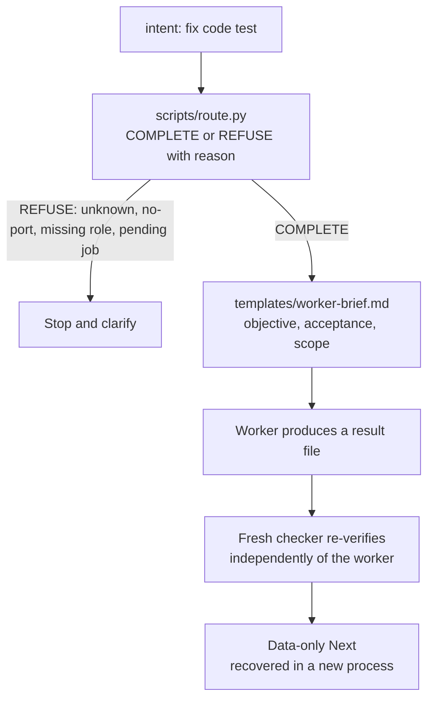

<p><picture><source media="(prefers-color-scheme: dark)" srcset="assets/banner-dark.svg"></picture></p>

**Report-only routing, maker/checker review and resumable handoffs for AI-assisted work, as skills and offline tools you can copy.**

[Install](INSTALL.md) · [Catalog](CATALOG.md) · [Design decisions](#design-decisions) · [Site](https://nikkhosravipour.com)

[](LICENSE) [](LICENSE-docs) [](CHANGELOG.md)



## Install

```text
/plugin marketplace add nik110403/ai-architecture
/plugin install ai-architecture@ai-architecture
```

Or copy a single directory such as `skills/planning/` into your project; see [INSTALL.md](INSTALL.md).

## Why it exists

AI-assisted work drifts: scope widens, the worker grades its own output, and a session's state dies with its context. This collection is a partial, generic extract of one personal working setup: some pieces run, others are described, and several are not included. Each piece is a small, checkable artifact instead of a framework. It does not run agents for you; it gives you the roles, briefs, checks and handoff records, and tells you honestly what your harness must still enforce.

## What runs vs what is described

| Piece | State | Notes |
|---|---|---|
| Routing demo (`scripts/route.py`) | runnable | Offline demo of the routing decision; it reports, it is not an automatic router. |
| Collection checker (`scripts/check_collection.py`) | runnable | Offline structure and link checks. |
| Privacy scan (`scripts/privacy_scan.py`) | runnable | Flags private paths and host names in the tree. |
| Skills | described | Instructions an agent follows. |
| Roles and commands | described | Declarations for Claude Code; nothing enforces them. |
| Continuity journal tool (`skills/continuity/scripts/journal.py`) | runnable | Small local script for saving and reading a handoff record. |
| Automatic model routing and rotation | not included | |
| Hook gates | not included | |
| Maintenance loops | not included | |

## What's inside

| Component | Role | Folder |
|---|---|---|
| Skills | Portable workflows: planning, delegation, review, continuity, discovery, specialist journeys and more (18) | `skills/` |
| Roles | Claude-native declarations for builder, verifier, refuter, researcher and reviewers (6) | `agents/` |
| Commands | Claude-native entrypoints such as `/ai-architecture:plan` (6) | `commands/` |
| Rules | Guidance to merge by hand with your project rules | `rules/` |
| Templates | Worker brief, result, review, lifecycle record and more | `templates/` |
| Adapters | Notes for using the collection outside Claude Code | `adapters/` |
| Scripts | Report-only router and the collection check | `scripts/` |
| Examples | Runnable fixtures: system journey, continuity, parser | `examples/` |
| Tools | Banner generator used for the images in this README | `tools/banner/` |

The system map is [CAPABILITIES.md](CAPABILITIES.md); journeys and boundaries are in [WORKFLOWS.md](WORKFLOWS.md).

## How a request flows

The [system journey](examples/system-journey/README.md) runs this path without a hosted model.



1. `scripts/route.py` classifies the intent against the capabilities and model roles you declare, and returns a report.
2. A worker gets a bounded brief and writes a result; it never grades itself.
3. A separate checker verifies the result against the acceptance line.
4. The next step is saved as data and recovered by a fresh process, so a lost context costs nothing.

## Design decisions

1. **Routing is report-only and refuses rather than guesses.** An unknown, mixed or no-port intent stops for clarification, because a confident wrong route costs more than a question.
2. **Maker and checker are separate.** The checker is a fresh context with its own role, because a worker reviewing its own output shares its blind spots.
3. **Next is data, not an instruction.** A saved handoff is inert text a later session reads and verifies, so recovering it cannot execute anything.
4. **Standard library only.** The router, checks and journal need Python 3 and nothing else, so they run offline and cannot go stale against a dependency.
5. **Copy one directory.** Each skill carries its own assets, so you can adopt one workflow without taking the rest.

## Reuse it

1. Run `python3 -B scripts/route.py --intent 'fix code test' --capabilities '{"capabilities":["code.builder","code.verifier"],"models":["builder","verifier"]}'` to get a report-only route.
2. Copy `skills/planning/` or a self-contained specialist skill intact using [INSTALL.md](INSTALL.md). This is release `0.3.2-preview`.
3. Give a worker `templates/worker-brief.md`; retain its result beside the work.
4. Have a fresh checker use `skills/convergence/` or `skills/review/`.
5. Record a data-only Next using `templates/lifecycle-record.md`.
6. For an explicit local Markdown bundle, run `python3 -B skills/discovery/scripts/memory_check.py --root PATH`; it only reports drift and scan gaps.

Start with [INSTALL.md](INSTALL.md), then choose a component in [CATALOG.md](CATALOG.md). Read [WORKFLOWS.md](WORKFLOWS.md) before whole-system adoption. Other harnesses should use [adapters/](adapters/); native Claude commands and roles are not imported by Codex or OpenCode automatically.

## Scope and limits

There are no hooks, rotation systems, enforced gates, background agents, provider discovery, model-account policy, or permission grants here. `scripts/route.py` accepts explicit availability and emits reporting states; manual mode is never native or enforced. Workflows describe a process; your repository and harness remain responsible for permissions and enforcement.

The system map is diagnostic, not whole-system runtime acceptance. Whole-runtime parity remains open: provider adapters, native enforcement, and unread families are still explicit gaps. See [CAPABILITIES.md](CAPABILITIES.md#reading-status) and [WORKFLOWS.md](WORKFLOWS.md#what-this-does-not-prove). Run the [system journey](examples/system-journey/README.md), [continuity fixture](examples/continuity/README.md) or [parser example](examples/worked-example/README.md) without a hosted model.

## License

Code and instruction assets are [MIT](LICENSE); documentation and images are CC BY 4.0 ([LICENSE-docs](LICENSE-docs)), mapped file by file in [LICENSES.md](LICENSES.md). Cite via the "Cite this repository" button ([CITATION.cff](CITATION.cff)).
