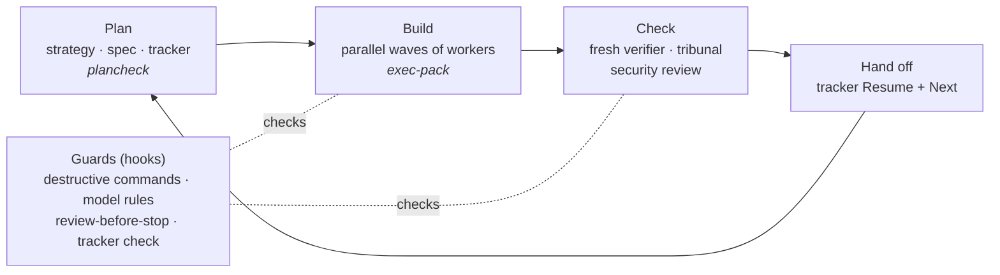

<p><picture><source media="(prefers-color-scheme: dark)" srcset="assets/banner-dark.svg"></picture></p>

**My entire philosophy for my Claude Code setup.**

[Install](INSTALL.md) · [Catalog](CATALOG.md) · [Architecture](ARCHITECTURE.md) · [How it works](#how-the-system-works) · [Site](https://nikkhosravipour.com)

[](LICENSE) [](LICENSE-docs) [](CHANGELOG.md)

I run advanced software and AI setups, built around the current standard of how to best use Claude Code. From
advanced agents and skills to best-effort security checks, this setup is trying to combine all of the frontier level
LLM abilities. Left alone, coding agents drift: the scope widens, the agent grades its own homework, a destructive
command slips through, and everything it knew dies when the context fills up. I have collected information on how
to best set up an AI system that checks itself and works as efficiently as possible. All of these ideas are now
applied to this repo in an attempt to make it more accessible to other people, so they don't have to start from
scratch. The system is based on my personal workflows, which means a lot of it is centered around research and
personal projects.



## How the system works

**1. Every model has a job, and the expensive ones don't type.** A strong model plans and orchestrates; a
cheaper one writes the code through an `implementer` agent; the cheapest does bounded reading. This is not a
convention: hooks block code edits by models configured as planners and cap how many edits an orchestrator may
make before it must delegate.

**2. Work starts as a plan pack.** Anything bigger than a small fix becomes `plans/<topic>/` with a strategy
(why), a spec (items with `Needs:`, `Touches:`, `Stakes:` and a `Verify:` command) and a tracker. `plancheck`
lints the pack. Each item is either `Gate: auto` (the agents just build it) or `Gate: human` (only for real
decisions: scope, money, publishing, taste).

**3. Builds run in waves.** `exec-pack` turns the spec's dependency graph into waves of parallel workers, each
in its own git worktree, fenced to the files its item declares. The orchestrator merges one branch at a time
and re-runs the verify loop on the merged tree.

**4. Nobody grades their own work.** A fresh-context `verifier` checks each item against its spec. High-stakes
changes also get a `security-reviewer` plus one `tribune` seat with a different lens; fixes are dispatched from
the seats' findings. A full **tribunal** (three or more judges with different lenses reviewing sealed, then arguing
in a shared transcript) is for high-stakes decisions and plans. A `refuter` tries to disprove SEV1 and SEV2 findings before
anyone acts on them (at HIGH stakes).

**5. Guards catch common mistakes.** An opt-in hook plugin is a best-effort tripwire against accidental destructive shell commands (not a security boundary; see its Known limitations), stops a session from
ending while a required review is missing, and nudges once when a session ends with a tracker that has no current Resume
block.

**6. Context is disposable; the tracker is not.** Each tracker carries a `Resume here` block (what was delivered,
current state, next action), overwritten at every milestone and injected into the next session. Clearing a
full context costs nothing. Long-lived facts live in small, linted memory files.

**7. Two harnesses, one system.** The same skills, agent roles and guards run in Claude Code and in OpenCode,
where worker models from several providers can be rotated by weighted pool.

**8. Maintenance runs on timers.** A morning digest, a weekly survey of the whole setup for drift, and a check
that every scheduled loop is still actually wired.

## What is in this repository

| Part | State | Where |
|---|---|---|
| Plan packs: plan-pack, exec-pack, tribunal skills + templates | in the repo (instructions) | `skills/`, `templates/` |
| `plancheck`, `gate-check`, `tribunal-scribe` | runnable, tested | `tools/` |
| Agent roles: implementer, verifier, tribune, refuter and more | in the repo | `agents/` |
| Stakes dial and routing rules | in the repo | `rules/` |
| Guard hooks (destructive commands, model rules, review gate, tracker check) | runnable, opt-in plugin | `plugins/gates/` |
| OpenCode bridge (same guards, plus a Bash check) and agent generator | runnable, opt-in; tested with a stub parser, not yet in a live OpenCode session | `opencode/` |
| Weighted model rotation (Claude Code hook + OpenCode module) | opt-in, tested (the OpenCode module half needs `bun`) | `opencode/rotation/`, `plugins/gates/hooks/rotation/` |
| `memcheck` (memory linter), `loop-sync` (timer registry check) | runnable, tested | `tools/` |
| Specialist workflows: review, discovery, continuity, research and more | in the repo (instructions) | `skills/` |
| Timer definitions for the maintenance loops | described only | [ARCHITECTURE.md](ARCHITECTURE.md) |
| Personal writing and voice tooling, personal data | not included | — |

Every ported file records where it came from and what changed in a PROVENANCE.md file next to it (PROVENANCE.txt for agents). A privacy
scan (`scripts/privacy_scan.py`) runs before every release as a tripwire for common personal markers in the public tree.

## A real example

While porting the guard hooks for this release, a three-judge review found that "read-only" reviewer agents
could still run code: `git status` and `git diff` execute programs named in a repository's own git config. The
same gap existed in my private setup. Two rounds of parser fixes each closed one bypass, and the judges found
the next one, so the guard was dropped from the plugin; the documentation now recommends reviewer agents with
no shell access at all. That loop — build, independent review, refute, fix, and stopping when patching stops
converging — is what the system is for.

## Use with your AI

You don't have to take all of it, or anything at all. Point your AI at this repository and ask what is worth
taking for you. An idea copied into your own instructions counts as much as an installed skill. This prompt
keeps your AI read-only:

```text
Read this repository, starting with README.md, ARCHITECTURE.md and CATALOG.md, and
compare it with how I work today. Do not install, copy or change anything. Tell me
the three to five ideas or components most worth taking for me, why each one fits,
and what adopting it would cost. Ideas I could write into my own instructions count
as much as files I could install. Say which ones you would skip and why.
```

To adopt what you picked, you do not need a plugin. Clone or download the repository, open your Claude Code
session in the folder, and give your agent the prompt below. It follows the [AI-led adoption guide](adapters/adopt.md): it asks
which scope it may look at, inventories what you already have, and only adds. It never replaces your files, and
it changes hooks or settings only after you approve each exact diff. It leaves a receipt that says how to undo
everything.

```text
Adopt the AI Architecture collection into my setup by following its adoption guide,
adapters/adopt.md, step by step. Before you change anything, ask me which scope you
may look at (my user-level Claude Code directory, or this project), then take an
inventory of that scope and write it down. Only add things: never replace, delete or
overwrite a file of mine. The only change allowed to a file that already exists is one
marked block appended to it, and only after you listed it for me and backed the file up.
Leave hooks and settings alone unless I say yes to each exact hook or settings change
after you show me the diff. When you finish, leave a receipt that says what you installed, what you could not, and how to undo it.
```

The plugin route remains available below and in [INSTALL.md](INSTALL.md).

## Install

```text
/plugin marketplace add nik110403/ai-architecture
/plugin install ai-architecture@ai-architecture          # skills, roles, templates, tools
/plugin install ai-architecture-gates@ai-architecture    # optional: the guard hooks (read plugins/gates/README.md first)
```

Or selectively copy a skill and its declared dependencies into your project. `plan-pack` also needs
root-level templates and tools; its T2+ execution uses companion skills and configured roles.
[INSTALL.md](INSTALL.md) covers OpenCode, user-level guard configuration and partial adoption.

## Design decisions

1. **Maker and checker are always different contexts.** A worker reviewing its own output shares its blind spots.
2. **Rules that matter are hooks, not prompts.** An instruction a model can forget is a suggestion.
3. **Humans approve strategy, agents decide technique.** Gates sit on scope, money, publishing and taste; merges
   and fixes go through a reviewer instead of a person.
4. **Ceremony scales with stakes.** A typo fix gets a test run; a security boundary gets a `security-reviewer` plus a `tribune` seat with a different lens, and a high-stakes plan gets a full tribunal.
5. **Guards are tripwires with accepted allow-classes, configured at user level.** Static text checks catch common destructive command forms; they are not a sandbox and omit declared classes. The plugin reads its configuration only from your user scope, so a repository cannot loosen it through this plugin's config files. Claude Code settings are outside the plugin's control: a project's Claude Code settings file (`<project>/.claude/settings.json`) can still set `disableAllHooks`, `enabledPlugins: false` or `env` values.
6. **Standard library only.** The tools need bash and Python 3, so they run offline and don't rot.

## Limits

Preview. Built and used on one Linux machine with Claude Code and OpenCode; other systems are untested, apart from one adoption smoke run on Windows 11 that did not pass every check. No capability is marked available: 59 run from this collection with fakes or declared tools, 13 need something not included. Adoption was rehearsed once: a Claude Code agent followed adapters/adopt.md in this release onto a test home we prepared with its own CLAUDE.md, settings and skills. A separate checker found every existing file unchanged outside marked blocks, a second run changed nothing, and rollback restored the starting state. 0 of 14 chosen capabilities passed their check, run by the same agent: 8 were installed but not checked, and 6 were marked unavailable. Earlier runs, including the failed ones, are listed in examples/adoption/REHEARSAL.md. Hooks were not rehearsed. No outside person has adopted it yet.

On Windows the tools need bash, Python 3 and GNU coreutils; WSL is closest to what was tested.
Skills are instructions an agent follows, so results depend on the model. The guard hooks rely on Claude Code's
hook payloads and transcript format, which can change between versions. See [COVERAGE.md](COVERAGE.md) for what
has been tested and how.

## License

Code and instruction assets are [MIT](LICENSE); documentation and images are CC BY 4.0 ([LICENSE-docs](LICENSE-docs)),
mapped file by file in [LICENSES.md](LICENSES.md). Cite via the "Cite this repository" button ([CITATION.cff](CITATION.cff)).

Built by [Nik Khosravipour](https://nikkhosravipour.com).
